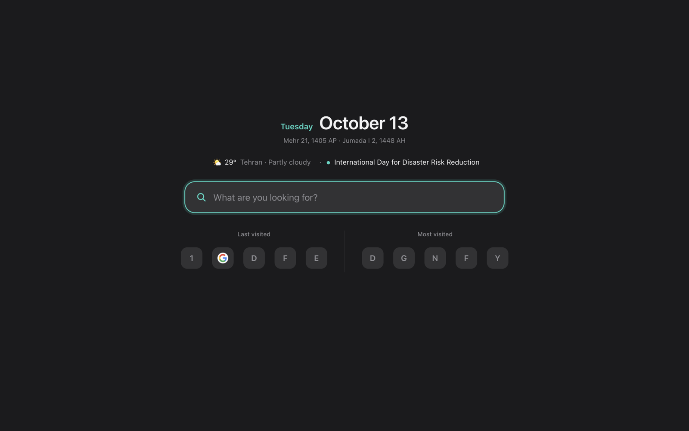

# Sade

A minimal web browser for macOS. The whole interface is one 40-pixel bar; the rest of the window is the page.

*Sade* (ساده) is Persian for "simple".



> **Status: a personal project, not a hardened browser.** Sade is built on Electron, so its Chromium lags behind Chrome, it has no automatic updates and no Safe Browsing. Don't rely on it for banking or other sensitive work. See [Limitations](#limitations).

## Features

**Interface**
- One bar: back, forward, reload, tabs, extension buttons and settings. Nothing else.
- The active tab doubles as the address field. Click it (or press `⌘L`) to edit the address in place.
- Tabs can be dragged to reorder, pinned, duplicated and moved to a new window.
- Light and dark themes, following the system or set by hand.
- English, Persian (right-to-left) and Russian. The language switches live, without a restart.

**Dashboard (new tab)**
- Today's date in the Gregorian, Persian and Islamic calendars.
- Today's occasion, or the next one coming up (about 90 Iranian, Islamic and international days).
- Weather for a city you choose.
- A single search field with suggestions from open tabs, bookmarks, history and commands.
- The sites you visited last and the ones you visit most, as one row of icons with no repeats.

**Browsing**
- Chrome extensions, installed straight from the Chrome Web Store.
- Private windows that keep nothing on disk.
- Find in page, zoom, printing, the built-in PDF viewer and HTTP sign-in prompts.
- Two-finger swipe for back and forward, with an on-screen hint.
- Per-site permission prompts (camera, microphone, location, notifications) that can be revoked later.
- A reload button that shows what it is doing: blue for a plain reload, yellow for one that skips the cache, turning faster or slower with the real download speed.

**Your data**
- A built-in password manager. Passwords are encrypted with a key held in the macOS Keychain; showing or copying one asks for Touch ID.
- Import bookmarks and history from Chrome and Safari.
- Import passwords from Chrome directly, and from Safari or any other manager through a CSV export.
- Bookmarks, history, downloads, passwords and site permissions each have their own page, with search.

## Running it

Requirements: macOS and [Node.js](https://nodejs.org) 20 or newer. Developed and tested on Apple silicon.

```bash
git clone https://github.com/MOHAMADMOASVI/sade-browser.git
cd sade-browser
npm install
npm start
```

To build a standalone app:

```bash
npm run build
```

This produces `dist/Sade-darwin-arm64/Sade.app`. The build is signed ad hoc, which is enough to run it on the Mac that built it but not to distribute it.

Two double-clickable scripts do the same from Finder: `start.command` runs Sade without a build, and `build.command` builds the app.

## Keyboard shortcuts

| Action | Shortcut |
|---|---|
| New tab | `⌘T` |
| New window / new private window | `⌘N` / `⇧⌘N` |
| Edit the address | `⌘L` |
| Close tab / reopen closed tab | `⌘W` / `⇧⌘T` |
| Next / previous tab | `⌃Tab` / `⌃⇧Tab` |
| Jump to tab 1–8, last tab | `⌘1`–`⌘8`, `⌘9` |
| Back / forward | `⌘[` / `⌘]` |
| Reload / reload without cache | `⌘R` / `⇧⌘R` |
| Find in page | `⌘F` |
| Bookmark this page | `⌘D` |
| Bookmarks / history / downloads | `⌥⌘B` / `⌘Y` / `⌥⌘L` |
| Dashboard | `⇧⌘H` |
| Settings | `⌘,` |
| Print | `⌘P` |
| Developer tools | `⌥⌘I` |

## Privacy

Everything Sade remembers stays on your Mac, in `~/Library/Application Support/Sade`. There is no account and no sync.

Two features talk to an outside service:

- **Weather** sends the coordinates of the city you chose to [Open-Meteo](https://open-meteo.com). Nothing is sent until you enter a city.
- **Extensions** are downloaded from the Chrome Web Store when you install them.

Importing from another browser reads that browser's files on your Mac. Importing Chrome's passwords makes macOS ask for your Mac password first; Safari's bookmarks and history need Full Disk Access.

## Limitations

- **Security.** Electron's Chromium is behind Chrome's, and Sade does not update itself or check sites against Safe Browsing.
- **Extensions.** They install, but Electron supports only part of the extension API, so some work partly or not at all. Extensions that need a helper app on the Mac (such as iCloud Passwords) cannot work.
- **Protected video.** Netflix, Spotify and other DRM content will not play.
- **Sign-in with Google** may be refused on some sites.
- **Passwords.** There is no sync with iCloud Keychain or a Google account, sign-in forms inside frames are not detected, and there are no one-time codes.
- **Occasions.** Islamic dates are calculated rather than based on moon sighting, so they can be a day off from the official calendar.
- **Signing.** Because the build is signed ad hoc, macOS may ask again for Keychain access after each new build.

## Project layout

```
src/            main process
  main.js         app start-up, menus, messaging with the pages
  window.js       a browser window: its tabs, navigation, context menus
  data.js         bookmarks, history, downloads, permissions, settings
  passwords.js    the password manager and its importers
  importers.js    bookmarks and history from Chrome and Safari
  weather.js      weather lookup
ui/             pages and the scripts that run inside tabs
  bar.*           the top bar
  dashboard.*     the new-tab page
  library.*       bookmarks, history, downloads, passwords, permissions, settings
  occasions.js    the calendar of occasions
  strings.js      Persian and Russian translations
build/          app icon and the packaging script
```

## Built with

[Electron](https://www.electronjs.org), and [electron-chrome-extensions](https://github.com/samuelmaddock/electron-browser-shell) for extension support. The latter is licensed under GPL-3.0, which applies to Sade as well if it is distributed.

---

## فارسی

Sade («ساده») یک مرورگر مینیمال برای macOS است. کل رابط کاربری یک نوار ۴۰ پیکسلی است و بقیهٔ پنجره صفحهٔ وب.

- **رابط:** تب فعال همان نوار آدرس است؛ با کلیک روی آن یا `⌘L` آدرس را همان‌جا ویرایش می‌کنید. سه زبان فارسی، انگلیسی و روسی دارد.
- **داشبورد:** تاریخ شمسی، میلادی و قمری، مناسبت روز، آب‌وهوا، جست‌وجو، و آخرین و پربازدیدترین سایت‌ها.
- **امکانات:** افزونه‌های کروم، پنجرهٔ خصوصی، مدیریت گذرواژه با رمزگذاری در Keychain، و وارد کردن نشانک، تاریخچه و گذرواژه از کروم و سافاری.

برای اجرا به macOS و Node.js نسخهٔ ۲۰ یا بالاتر نیاز است:

```bash
npm install
npm start
```

این یک پروژهٔ شخصی است و مرورگر امن‌شده‌ای نیست؛ برای کارهای بانکی و حساس از آن استفاده نکنید. محدودیت‌ها در بخش [Limitations](#limitations) آمده‌اند.
